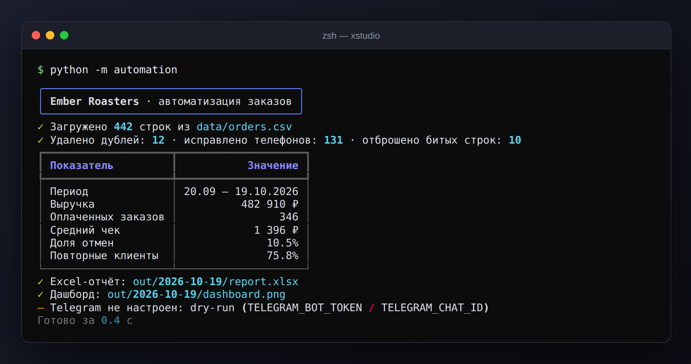
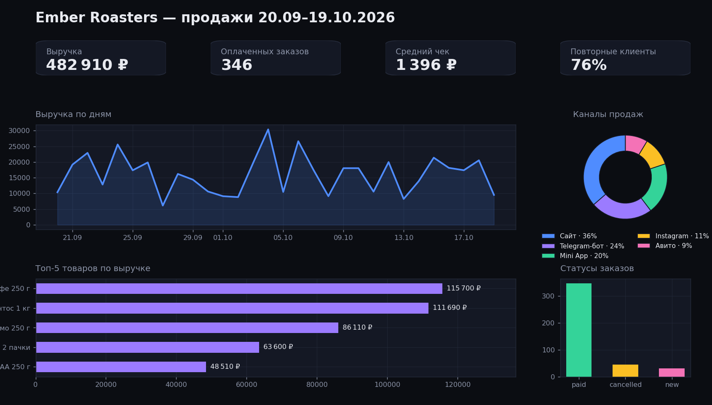
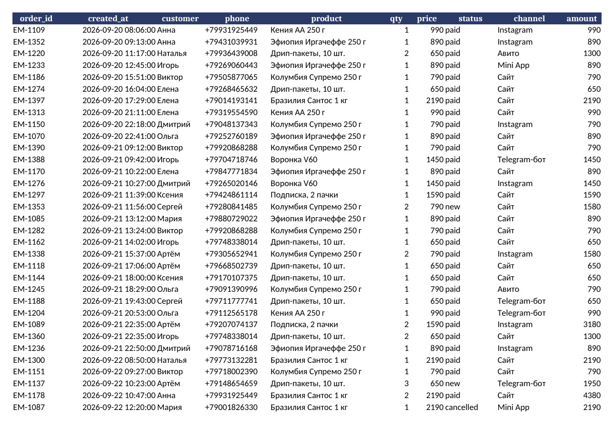

# Автоматизация заказов и отчётности

> Демо-проект XSTUDIO · Python · pandas · openpyxl · matplotlib · rich

**Задача.** Каждое утро владелец кофейни (вымышленный бренд **Ember Roasters**) вручную сводил выгрузки заказов из разных каналов в Excel: около часа рутины, дубли и «кривые» телефоны. Скрипт делает то же за секунды и сам присылает итог в Telegram.

## Что умеет
- Читает выгрузку заказов (CSV — из CRM, сайта, Google Sheets).
- Чистит данные: дубликаты, телефоны к единому формату `+7XXXXXXXXXX`, битые строки.
- Считает KPI: выручка, средний чек, доля отмен, повторные клиенты, топ товаров, каналы продаж.
- Собирает Excel-отчёт (4 листа) и PNG-дашборд.
- Отправляет сводку в Telegram; без токена работает в режиме dry-run.
- Запускается по расписанию: cron, Планировщик Windows или GitHub Actions.

## Скриншоты




## Запуск
```bash
pip install -r requirements.txt
python -m automation.demo_data     # сгенерировать демо-заказы (data/orders.csv)
python -m automation               # отчёт появится в out/<дата>/
pytest -q                          # тесты
```
Сводка в Telegram: скопируйте `.env.example` в `.env`, заполните `TELEGRAM_BOT_TOKEN` и `TELEGRAM_CHAT_ID`.

Ежедневный запуск в 08:00 через cron:
```
0 8 * * * cd /opt/automation && python -m automation --input /data/orders.csv
```

## Структура
```
automation/pipeline.py   очистка данных и KPI
automation/report.py     Excel и дашборд
automation/notify.py     Telegram
tests/                   pytest
```

## Как адаптировать под ваш бизнес
Источник данных меняется одной функцией: Google Sheets API, выгрузка из 1С, amoCRM или Bitrix24, база данных. KPI и вид отчёта настраиваются под ваши метрики.

---
Данные в демо сгенерированы (`automation/demo_data.py`), реальных клиентов и заказов здесь нет.
